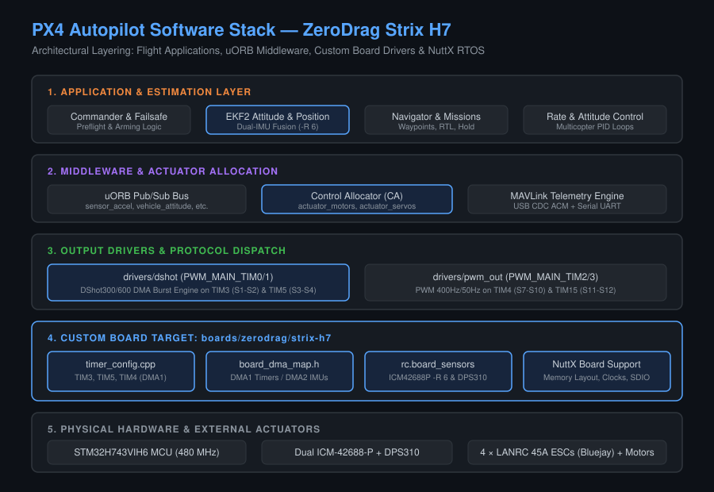
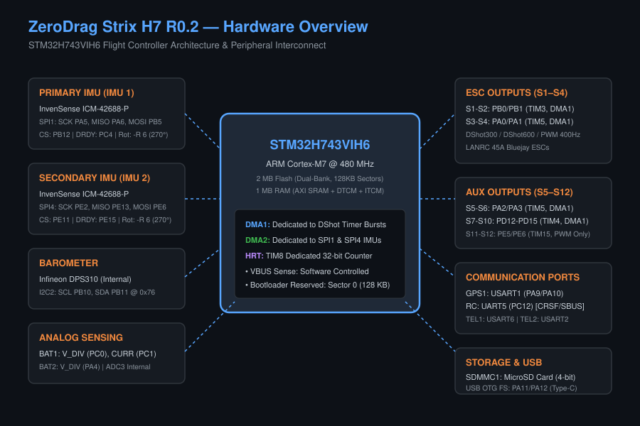
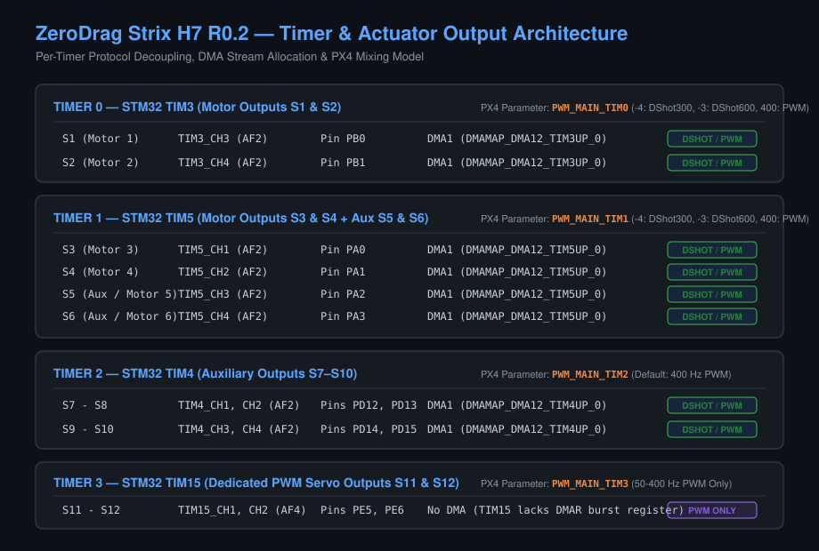

<p align="center">
  
</p>

# PX4 Autopilot — ZeroDrag Strix H7 R0.2 Board Port

[](https://px4.io/)
[](https://github.com/PX4/PX4-Autopilot)
[](https://www.st.com/)
[](LICENSE)

An industrial-grade, open-source **PX4 Autopilot v1.18** firmware port for the **ZeroDrag Strix H7 R0.2** flight controller. This repository contains the complete custom board target, peripheral drivers, DMA architecture, timer configurations, and NuttX RTOS integration supporting multirotor, fixed-wing, and VTOL autonomous flight systems.

---

## 1. Project Title & Introduction

The **PX4-ZeroDrag-Strix-H7** project brings the power, modularity, and safety-critical flight control of PX4 to the ZeroDrag Strix H7 R0.2 hardware platform. Powered by an STMicroelectronics STM32H743VIH6 ARM Cortex-M7 microcontroller running at 480 MHz, this port features redundant dual ICM-42688-P IMUs, high-precision barometric sensing, low-latency DShot motor output, and dedicated DMA channel arbitration.

---

## 2. Project Overview

This repository is maintained as a fully standalone, buildable PX4 firmware source tree based on PX4 v1.18. It integrates:
* **Custom Board Definition**: Located under [`boards/zerodrag/strix-h7/`](boards/zerodrag/strix-h7/).
* **Dual-IMU Redundancy**: Seamless sensor voting and failover between primary (SPI1) and secondary (SPI4) InvenSense ICM-42688-P IMUs.
* **Low-Latency Actuator Engine**: Up to 12 timer-driven actuator outputs supporting DShot300, DShot600, OneShot, and standard 50–400 Hz PWM.
* **DMA Conflict Elimination**: Dedicated hardware DMA controllers separating high-frequency motor bursts (DMA1) from sensor acquisition (DMA2).
* **NuttX RTOS Integration**: Custom linker scripts and board definitions tailored to the STM32H743 2 MB dual-bank flash memory structure.



---

## 3. Supported Hardware

The firmware is designed and validated for the following reference flight setup:
* **Flight Controller**: ZeroDrag Strix H7 R0.2
* **Airframe**: F450 Quadcopter (`SYS_AUTOSTART = 4001`)
* **Motors**: 4 × 2212 920KV brushless motors
* **ESCs**: 4 × LANRC 45A BLHeli_S running Bluejay firmware
* **Propellers**: 1045 composite propellers
* **Power**: 3S–4S LiPo battery with dual analog voltage/current monitoring
* **Receiver**: ExpressLRS / Crossfire (CRSF) via UART5

---

## 4. Flight Controller Specifications

| Feature | Specification |
| :--- | :--- |
| **Microcontroller** | STM32H743VIH6 (Cortex-M7 @ 480 MHz, Double Precision FPU, L1 Cache) |
| **Flash Memory** | 2 MB Dual-Bank Internal Flash (16 sectors × 128 KB) |
| **RAM** | 1024 KB Total (512 KB AXI SRAM, 128 KB DTCM, 64 KB ITCM, 288 KB SRAM1-3) |
| **Primary IMU** | InvenSense ICM-42688-P on `SPI1` (Active Low CS `PB12`, DRDY `PC4`) |
| **Secondary IMU** | InvenSense ICM-42688-P on `SPI4` (Active Low CS `PE11`, DRDY `PE15`) |
| **Barometer** | Infineon DPS310 on `I2C2` (`PB10` / `PB11`, Address `0x76` / 118 dec) |
| **External Compass Bus** | `I2C1` via external connector (`PB8` / `PB9`) |
| **Storage** | MicroSD card socket connected via 4-bit SDMMC1 interface |
| **USB Interface** | USB Type-C OTG Full Speed (`PA11` DM, `PA12` DP) |
| **Serial Ports** | 6 hardware UART/USART ports (GPS1, RC, TEL1, TEL2, TEL3, TEL4) |
| **Power Inputs** | Dual analog battery monitor inputs (BAT1 on `PC0`/`PC1`, BAT2 on `PA4`) |



---

## 5. Hardware Compatibility & Status

To maintain transparent open-source reporting, hardware capabilities are categorized by verification level:

| Subsystem | Hardware Component | Port Implementation | Validation Status |
| :--- | :--- | :---: | :---: |
| **Core RTOS** | STM32H743 Clock Tree (480 MHz) | Complete | **Tested & Working** |
| **Bootloader** | Custom NuttX BL (Sector 0, `26ac:0050`) | Complete | **Tested & Working** |
| **Primary IMU** | ICM-42688-P on SPI1 (Rotation `-R 6`) | Complete | **Tested & Working** |
| **Secondary IMU** | ICM-42688-P on SPI4 (Rotation `-R 6`) | Complete | **Tested & Working** |
| **Barometer** | Infineon DPS310 on I2C2 (`0x76`) | Complete | **Tested & Working** |
| **Attitude EKF2** | Dual-IMU Fusion & Level Estimation | Complete | **Tested & Working** |
| **Storage** | SDMMC1 4-bit MicroSD Logging | Complete | **Tested & Working** |
| **USB MAVLink** | CDC-ACM Shell & Telemetry | Complete | **Tested & Working** |
| **RC Input** | UART5 (CRSF / SBUS protocol) | Complete | **Tested & Working** |
| **Motor PWM** | S1–S12 Standard PWM (50–400 Hz) | Complete | **Tested & Working** |
| **Motor DShot** | S1–S4 Digital DShot300 / DShot600 | Complete | **Tested & Working** |
| **Bidirectional DShot** | BDShot RPM Telemetry | Configured | *Under Evaluation* |
| **External Mag** | External I2C Compass on GPS port | Implemented | *Not Yet Bench Tested* |

---

## 6. Features & Implementation Details

* **Sensor Rotation Alignment**: The PCB places both ICM-42688-P IMUs rotated 270° clockwise relative to the FC forward arrow. The board sensor script [`init/rc.board_sensors`](boards/zerodrag/strix-h7/init/rc.board_sensors) initializes both IMUs with `-R 6` (`ROTATION_YAW_270`), producing an upright, level attitude ($Z \approx -9.81\text{ m/s}^2$, Roll/Pitch $\approx 0^\circ$).
* **Safe VBUS Teardown**: Includes a critical fix in [`platforms/nuttx/src/bootloader/stm/stm32_common/main.c`](platforms/nuttx/src/bootloader/stm/stm32_common/main.c) preventing unintended reconfiguration of shared pins during bootloader handoff.
* **Flash Protection**: Parameter storage resides in Sector 15 (`0x081E0000–0x081FFFFF`), completely isolated from the application code (Sectors 1–12) and bootloader (Sector 0).

---

## 7. Custom Board Architecture

The board port is implemented cleanly within standard PX4 target conventions:
* [`boards/zerodrag/strix-h7/default.px4board`](boards/zerodrag/strix-h7/default.px4board): Defines module and driver selections.
* [`boards/zerodrag/strix-h7/src/timer_config.cpp`](boards/zerodrag/strix-h7/src/timer_config.cpp): Maps hardware timers, channels, and DMA assignments.
* [`boards/zerodrag/strix-h7/nuttx-config/include/board_dma_map.h`](boards/zerodrag/strix-h7/nuttx-config/include/board_dma_map.h): Configures DMAMUX streams.
* [`boards/zerodrag/strix-h7/init/rc.board_sensors`](boards/zerodrag/strix-h7/init/rc.board_sensors): Handles sensor drivers and bus configuration.

---

## 8. Timer & Output Mapping

The 12 output channels map to STM32 timers as follows:

| Output | PX4 Channel | Hardware Timer | Channel | STM32 Pin | DMA Controller | Supported Protocols | Default Function |
| :---: | :---: | :---: | :---: | :---: | :---: | :---: | :--- |
| **S1** | Channel 0 | TIM3 | CH3 (AF2) | `PB0` | DMA1 | DShot300/600, PWM | Motor 1 |
| **S2** | Channel 1 | TIM3 | CH4 (AF2) | `PB1` | DMA1 | DShot300/600, PWM | Motor 2 |
| **S3** | Channel 2 | TIM5 | CH1 (AF2) | `PA0` | DMA1 | DShot300/600, PWM | Motor 3 |
| **S4** | Channel 3 | TIM5 | CH2 (AF2) | `PA1` | DMA1 | DShot300/600, PWM | Motor 4 |
| **S5** | Channel 4 | TIM5 | CH3 (AF2) | `PA2` | DMA1 | DShot300/600, PWM | Aux 1 / Motor 5 |
| **S6** | Channel 5 | TIM5 | CH4 (AF2) | `PA3` | DMA1 | DShot300/600, PWM | Aux 2 / Motor 6 |
| **S7** | Channel 6 | TIM4 | CH1 (AF2) | `PD12` | DMA1 | DShot300/600, PWM | Aux 3 / Servo 1 |
| **S8** | Channel 7 | TIM4 | CH2 (AF2) | `PD13` | DMA1 | DShot300/600, PWM | Aux 4 / Servo 2 |
| **S9** | Channel 8 | TIM4 | CH3 (AF2) | `PD14` | DMA1 | DShot300/600, PWM | Aux 5 / Servo 3 |
| **S10** | Channel 9 | TIM4 | CH4 (AF2) | `PD15` | DMA1 | DShot300/600, PWM | Aux 6 / Servo 4 |
| **S11** | Channel 10 | TIM15 | CH1 (AF4) | `PE5` | None | PWM Only (50–400 Hz) | Aux 7 / Servo 5 |
| **S12** | Channel 11 | TIM15 | CH2 (AF4) | `PE6` | None | PWM Only (50–400 Hz) | Aux 8 / Servo 6 |



---

## 9. DShot Implementation & Configuration

PX4 v1.18 configures actuator output protocols on a **per-timer basis** rather than using the legacy `DSHOT_CONFIG` parameter. Each timer group is configured via `PWM_MAIN_TIM<timer_index>`:

* **Timer 0 (TIM3, S1–S2)**: Controlled by parameter **`PWM_MAIN_TIM0`**
* **Timer 1 (TIM5, S3–S6)**: Controlled by parameter **`PWM_MAIN_TIM1`**
* **Timer 2 (TIM4, S7–S10)**: Controlled by parameter **`PWM_MAIN_TIM2`**
* **Timer 3 (TIM15, S11–S12)**: Controlled by parameter **`PWM_MAIN_TIM3`**

### Protocol Parameter Values
| Protocol | Parameter Value | Behavior |
| :--- | :---: | :--- |
| **Standard PWM** | `400` (or `50`) | Standard analog PWM at specified frequency (Hz) |
| **OneShot125** | `-1` | Fast analog pulse |
| **DShot150** | `-5` | 150 kbit/s digital DShot |
| **DShot300** | **`-4`** | **300 kbit/s digital DShot (Recommended)** |
| **DShot600** | **`-3`** | **600 kbit/s digital DShot** |
| **BDShot300** | `-7` | Bidirectional DShot300 |

### Enabling DShot300 on S1–S4
Because motors 1–4 span Timer 0 (S1–S2) and Timer 1 (S3–S4), **both timers must be set to `-4`**:
```sh
param set PWM_MAIN_TIM0 -4
param set PWM_MAIN_TIM1 -4
param save
reboot
```

---

## 10. DMA Configuration

High-frequency motor output bursts require high DMA bandwidth. To prevent arbitration delays with flight sensor data, DMA channels are strictly segregated:
* **DMA1**: Assigned to Timer Burst updates (`TIM3_UP`, `TIM5_UP`, `TIM4_UP`).
* **DMA2**: Assigned to high-rate sensor polling (`SPI1_RX/TX` for IMU 1, `SPI4_RX/TX` for IMU 2).

This ensures jitter-free DShot timing even during 8 kHz gyro sampling.

---

## 11. Motor Output Mapping

Standard Quadcopter X configuration assigns motor outputs according to PX4 conventions:
* **Channel 0 (S1)**: Motor 1 (Right Front — Counter-Clockwise)
* **Channel 1 (S2)**: Motor 2 (Left Back — Counter-Clockwise)
* **Channel 2 (S3)**: Motor 3 (Left Front — Clockwise)
* **Channel 3 (S4)**: Motor 4 (Right Back — Clockwise)

Actuator function parameters:
```text
PWM_MAIN_FUNC1 = 101 (Motor 1)
PWM_MAIN_FUNC2 = 102 (Motor 2)
PWM_MAIN_FUNC3 = 103 (Motor 3)
PWM_MAIN_FUNC4 = 104 (Motor 4)
```

---

## 12. Build Requirements

* **Host OS**: Ubuntu Linux 20.04, 22.04, or 24.04 LTS (x86_64 or aarch64)
* **Cross-Compiler**: `arm-none-eabi-gcc` & `arm-none-eabi-g++` (v10.3 to v13.2)
* **Build Tools**: `cmake` (>= 3.20), `ninja-build`, `git`, `astyle`
* **Python**: Python 3.8+ with `jinja2`, `empy==3.3.4`, `kconfiglib`, `pyyaml`, `toml`

---

## 13. Installation of Dependencies

On Ubuntu / Debian:
```bash
sudo apt update
sudo apt install -y build-essential cmake ninja-build gcc-arm-none-eabi \
    libnewlib-arm-none-eabi libstdc++-arm-none-eabi-newlib python3-pip git astyle

pip3 install --user kconfiglib jinja2 empy==3.3.4 pyros-genmsg pyyaml toml packaging cerberus
```

---

## 14. Cloning the Repository

Clone recursively to fetch all required submodules (NuttX, drivers, libraries):

```bash
git clone --recursive https://github.com/<USERNAME>/PX4-ZeroDrag-Strix-H7.git
cd PX4-ZeroDrag-Strix-H7
```

---

## 15. Building the Firmware

Execute the build command from the root directory:

```bash
make zerodrag_strix-h7_default
```

### Firmware Output Location
Upon completion, the deployable package is generated at:
```text
build/zerodrag_strix-h7_default/zerodrag_strix-h7_default.px4
```
* Raw Binary: `build/zerodrag_strix-h7_default/zerodrag_strix-h7_default.bin` (Linked at `0x08020000`)
* ELF Debug Image: `build/zerodrag_strix-h7_default/zerodrag_strix-h7_default.elf`

To build the standalone bootloader:
```bash
make zerodrag_strix-h7_bootloader
```

---

## 16. Flashing Firmware via USB

### Normal Application Update
Connect the board to your computer via USB Type-C:
```bash
python3 Tools/px4_uploader.py --port /dev/ttyACM0 build/zerodrag_strix-h7_default/zerodrag_strix-h7_default.px4
```

### Full Bootloader Recovery via ROM DFU
If Sector 0 was overwritten (e.g. from flashing Betaflight):
1. Enter STM32 system ROM DFU mode by holding the `BOOT` button while plugging in USB (`0483:df11`).
2. Flash the bootloader into Sector 0 (`0x08000000`):
   ```bash
   dfu-util -a 0 -d 0483:df11 -s 0x08000000:leave -D build/zerodrag_strix-h7_bootloader/zerodrag_strix-h7_bootloader.bin
   ```
3. The board reboots into the custom PX4 bootloader (`26ac:0050`). Now upload the application firmware via `px4_uploader.py`.

See [`docs/FLASHING.md`](docs/FLASHING.md) for full instructions.

---

## 17. Connecting to QGroundControl

1. Launch **QGroundControl** (v4.2 or later).
2. Connect the ZeroDrag Strix H7 via USB Type-C.
3. QGC will connect automatically over MAVLink CDC-ACM on `/dev/ttyACM0`.
4. The vehicle status banner will report **PX4 Autopilot v1.18** on `ZERODRAG_STRIX_H7`.

---

## 18. ESC Configuration & Setup

For LANRC 45A ESCs running Bluejay:
1. Flash Bluejay firmware (v0.19 or later recommended) using ESC Configurator.
2. Select **48 kHz** or **24 kHz** PWM frequency based on your motor preference.
3. Ensure motor rotation directions are configured correctly.
4. When powered by the flight battery under PX4 with DShot300 configured, ESCs will sound three rising startup tones followed by two arming beeps.

---

## 19. Parameter Configuration

Essential parameters configured for this target:
* `SYS_AUTOSTART = 4001` (Generic Quadcopter F450)
* `PWM_MAIN_TIM0 = -4` (DShot300 on S1–S2)
* `PWM_MAIN_TIM1 = -4` (DShot300 on S3–S6)
* `PWM_MAIN_TIM2 = 400` (PWM 400 Hz on S7–S10)
* `PWM_MAIN_TIM3 = 400` (PWM 400 Hz on S11–S12)
* `BAT1_V_DIV = 11.0` (Main battery voltage divider)
* `BAT1_A_PER_V = 40.0` (Main battery current scaling)
* `SYS_HAS_MAG = 0` (Disable onboard compass check if no external GPS/mag is attached)

---

## 20. Troubleshooting

| Symptom | Cause | Solution |
| :--- | :--- | :--- |
| `dshot start` says `No channels configured` | `PWM_MAIN_TIM0` or `TIM1` set to `400` (PWM) | Set both `PWM_MAIN_TIM0` and `PWM_MAIN_TIM1` to `-4` and reboot. |
| Inverted attitude in QGC (Roll $\approx 180^\circ$) | IMU rotation set to `-R 14` instead of `-R 6` | Verify [`init/rc.board_sensors`](boards/zerodrag/strix-h7/init/rc.board_sensors) uses `-R 6` for both ICM42688P instances. |
| USB device detected as `0483:5740` (Betaflight) | Sector 0 contains Betaflight, not PX4 BL | Restore bootloader via `dfu-util` into Sector 0 (`0x08000000`). |
| Missing parameters after flash | Empty parameter storage | PX4 auto-seeds parameters from `/fs/microsd/parameters_backup.bson`. Run `param save`. |

---

## 21. Known Limitations

* **TIM15 PWM Only**: Outputs S11 and S12 (TIM15) do not support DShot because STM32 TIM15 lacks hardware DMAR burst registers. They are restricted to standard PWM (50–400 Hz).
* **Onboard Magnetometer**: The board has no internal compass; an external compass on `I2C1` is required for autonomous mission modes (Mission, Position Hold, Return-to-Launch).
* **Bidirectional DShot**: BDShot RPM telemetry capture is implemented in driver architecture but currently undergoing bench validation.

---

## 22. Development Roadmap

- [x] Board port bringup on STM32H743VIH6
- [x] Dual ICM-42688-P IMU drivers with `-R 6` orientation
- [x] Internal DPS310 digital barometer on I2C2
- [x] SDMMC1 4-bit MicroSD high-rate logging
- [x] DShot300 / DShot600 motor output engine
- [x] Per-timer DMA stream isolation
- [ ] Automated CI/CD build workflows via GitHub Actions
- [ ] Bidirectional DShot (BDShot) RPM notch filter tuning
- [ ] Official PX4 upstream board pull request

---

## 23. Project Structure

```text
.
├── boards/zerodrag/strix-h7/     # Custom ZeroDrag Strix H7 PX4 Board Port
│   ├── default.px4board          # Kconfig options and driver inclusions
│   ├── bootloader.px4board       # Bootloader build definition
│   ├── init/                     # Board startup scripts (rc.board_sensors, rc.board_defaults)
│   ├── nuttx-config/             # NuttX RTOS kernel defconfig, linker scripts, DMA mapping
│   └── src/                      # Board C/C++ hardware drivers (timer_config, spi, i2c, etc.)
├── docs/                         # Detailed Technical Documentation
│   ├── HARDWARE.md               # Hardware specification & complete pinout
│   ├── BUILD.md                  # Comprehensive toolchain and compilation guide
│   ├── FLASHING.md               # USB flashing and DFU bootloader recovery
│   ├── MOTOR_OUTPUT.md           # DShot / PWM timer architecture & testing
│   ├── DEVELOPMENT.md            # Port architecture and contribution guide
│   └── images/                   # Architecture, timer, and hardware SVG diagrams
├── platforms/nuttx/              # NuttX RTOS platform integration & bootloader
├── src/                          # PX4 Autopilot core modules, estimators, drivers
└── Tools/                        # Build scripts, uploaders, and developer tooling
```

---

## 24. Acknowledgements & Upstream PX4 References

* **PX4 Development Team**: For the open-source autopilot stack ([https://px4.io/](https://px4.io/)).
* **Dronecode Foundation**: Open-source robotics and aviation standards ([https://www.dronecode.org/](https://www.dronecode.org/)).
* **Apache NuttX**: Real-time operating system powering PX4 ([https://nuttx.apache.org/](https://nuttx.apache.org/)).
* **ZeroDrag**: Hardware engineering of the Strix H7 flight controller.

---

## 25. License

This project is licensed under the standard **BSD 3-Clause License** consistent with the upstream PX4 Autopilot project. See the [`LICENSE`](LICENSE) file for complete details.
